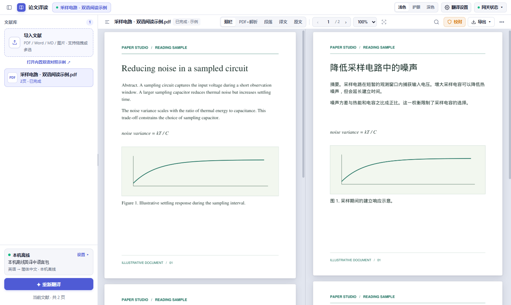
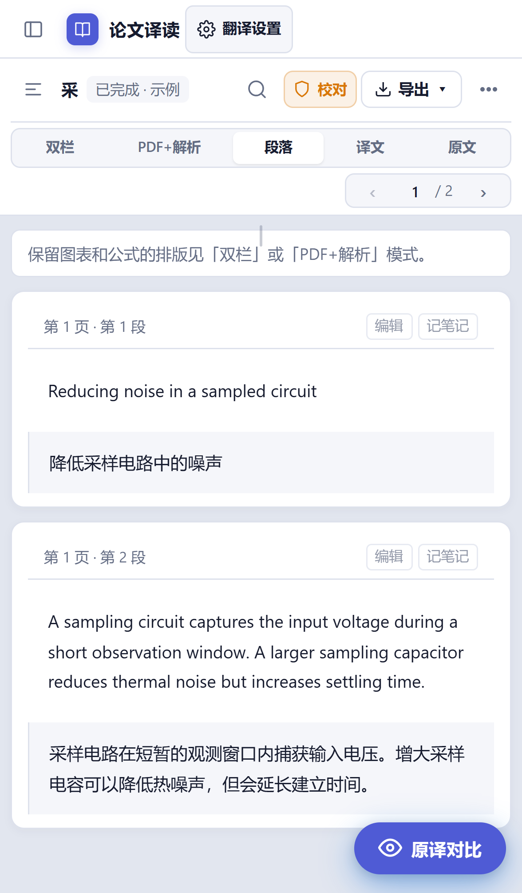
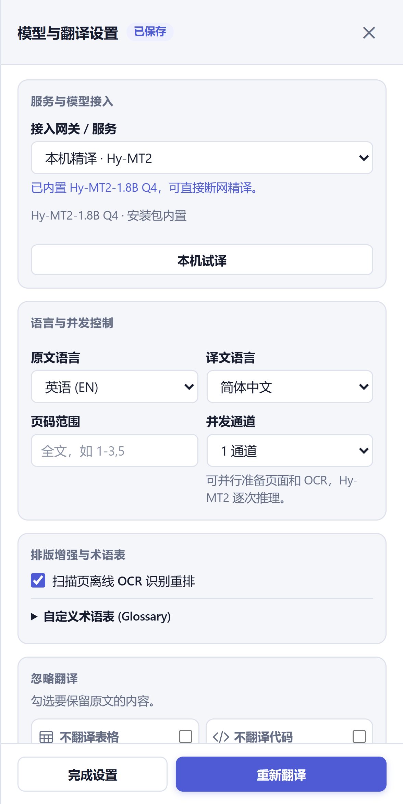

# 论文译读 · Paper Translation Studio

在 Windows、Android 手机和平板上翻译和精读学术文献。阅读区左侧是原文，右侧是排版译文。可以用本机翻译，也可以接入自己的大模型 API。

## 界面预览

### Windows 双栏阅读

左侧为原文 PDF，右侧为排版译文。内置示例展示了双栏对照中的公式与图表。



### Android 段落对照与本机精译

手机上可以逐段对照原文和译文，也可以在翻译设置里选择本机模型、语言、页码范围和扫描页 OCR。下图为 APK 的手机视口预览。

| 段落对照 | 内置 Hy-MT2 版的翻译设置 |
| :---: | :---: |
|  |  |

## 功能

- **双语阅读**。双栏连续滚动，可同步页码、拖动分隔线、锁定适应宽度。支持单看原文或译文、PDF 加结构化译文、双语段落和专注模式。
- **保留论文版面**。识别扫描页和双栏正文，尽量保留原图、图表、独立公式和角标。可选择跳过表格、代码、图片及参考文献。译文可导出为单语或双语 PDF、Markdown、HTML 和 Word 可读的 DOC。
- **精读与校对**。搜索原文和译文，在 PDF 中高亮并跳转。可以检查数字、单位和引用，单独重译段落、把修改写回 PDF，或保存可跳转的双语笔记。引用卡片、划词释义与术语表、LaTeX 复制依赖可提取的正文和公式信息。
- **减少重复请求**。支持只重试失败页。Android 可以退出后续译，API 缺段时只补发未通过校验的片段。同一文献、同一翻译配置下，可复用完全相同的普通正文译文。底栏分别显示本机复用段数和接口回传的前缀缓存命中率。

支持 PDF、DOCX、TXT、Markdown、PNG、JPEG 和 WebP，Windows 也支持 TIFF。DOCX 与文本导入时会重新分页。需要保留 Word 原有的复杂版式、插图或公式时，可先从 Word 导出 PDF。

## 从源码启动 Windows 工作台

1. 克隆本仓库。下载 PDFMathTranslate **v1.9.11** 的 Windows x64 带资产便携版 `pdf2zh-v1.9.11-with-assets-win64.zip`。 [上游发布页](https://github.com/PDFMathTranslate/PDFMathTranslate/releases/tag/v1.9.11)
2. 将便携版的 `pdf2zh` 目录放在本仓库旁边，保留 `build` 内的运行时、依赖与资源归档。也可以把 `PDF2ZH_HOME` 指向便携版的解压目录。

   ```text
   workspace/
   ├── paper-translation-studio/
   │   ├── start.bat
   │   └── server.py
   └── pdf2zh/
       └── build/
           ├── runtime/python.exe
           ├── site-packages/pdf2zh/
           └── offline_assets_*.zip
   ```

3. 在仓库目录运行 `.\start.bat`。脚本会在 Edge 或 Chrome 的应用窗口打开工作台，也可在浏览器访问 [127.0.0.1:8765](http://127.0.0.1:8765)。选择「打开内置双语对照示例」可以先体验阅读和导出。
4. 使用 Windows 本机英译中前，先在联网时运行 `.\start.bat --install-offline` 下载语言包，再启动工作台。

Windows 安装版 1.0.1 作为本机工作台运行。已构建的安装包位于本机 `output/windows/`，安装后从开始菜单打开「论文译读」。重新构建请看 [Windows 安装包构建](packaging/windows/BUILD.md)。

## Android 安装与连接

- **标准版**。Android 7.0 或更高版本，建议使用更新的 Android System WebView。可接入 API，也可用 Google ML Kit 设备端英译中。首次翻译需下载语言包，之后正文在设备上处理。扫描页 OCR、原文校对和单页重译在「更多」菜单中。 [ML Kit 设备端翻译](https://developers.google.com/ml-kit/language/translation)
- **内置 Hy-MT2 版**。面向 64 位设备，内置约 1.13 GB 的 Q4_K_M 权重。标准版也可以在翻译设置下载并导入同一官方 GGUF。 [Hy-MT2-1.8B-GGUF](https://huggingface.co/tencent/Hy-MT2-1.8B-GGUF)
- **打开电脑工作台**。在可信局域网内，用源码版的 `.\start.bat --lan` 启动电脑端，再展开 APK 翻译设置底部的「打开电脑工作台」并填写终端显示的地址。手机或平板会用系统浏览器打开电脑端，可使用电脑的排版引擎及已配置的服务。

已构建的 APK 位于本机 `output/android/`。当前源码版本为 Android **2.2.8**，文件名带 `-Offline` 的版本内置 Hy-MT2。构建与签名步骤见 [Android APK 构建](android-app/BUILD.md)。

## 配置翻译服务

| 服务 | 平台与接入方式 |
| --- | --- |
| 本机英译中 | Windows 使用 Argos 语言包，Android 使用 Google ML Kit。安装语言包后可断网翻译。 |
| Hy-MT2 | Android 64 位设备可导入 GGUF 或安装内置模型版。 |
| DeepSeek、Kimi、GLM、OpenAI、Gemini、硅基流动和自定义兼容 API | Windows 和 Android 均可填写 API 地址及密钥，再点「查询模型」读取服务端的模型列表。也可直接填写模型 ID。 |
| Magpie、Codex CLI 和 Antigravity CLI | 在 Windows 工作台连接已运行的 Magpie，或使用已登录的对应 CLI。Android 可通过「打开电脑工作台」使用这些连接。 |

## 使用流程

1. 点「导入文献」选择文件。文献导入后可先阅读原文。
2. 在「翻译设置」选择服务、原文与目标语言。使用 API 时，可以先点「测试连接」试译一句。页码范围留空表示全文，也可填写 1-3,5 这类范围。
3. 点「开始翻译」。部分页面失败时，点「只重试失败页」。Android 上退出后可重新打开同一文献，再点「继续剩余页」。
4. 在工具栏切换阅读模式、搜索或校对。段落上的「编辑」支持重译和写回 PDF，「记笔记」保存可跳转的原译文摘录。使用「导出」选择文件格式。

## 文献与设置

使用 API 时，待翻译的文字和所需的上下文会提交给选定服务。API Key 与文献库保存在设备本地。Windows 源码版默认使用仓库内的 `data/`，可用 `--data-dir` 指定位置。Windows 安装版使用 `%LOCALAPPDATA%\PaperTranslationStudio\data`。Android 的文献和缓存由应用管理，覆盖升级时应使用同一签名。

## 源码结构与验证

| 路径 | 内容 |
| --- | --- |
| `server.py`、`engine.py`、`providers.py` | Windows 本地服务、PDF 排版与翻译服务适配 |
| `document_import.py`、`scan.py`、`document_search.py`、`audit.py` | 文档导入、扫描识别、搜索与校对 |
| `static/` | 共用阅读器界面与交互 |
| `android-app/src/`、`android-app/web/`、`android-app/native/` | Android 文件和 PDF 处理、WebView 适配、Hy-MT2 推理库 |
| `packaging/windows/`、`build_apk.ps1` | Windows 安装器、Android 构建和签名 |
| `tests/` | 自动化测试 |

在按上文准备好 PDF2zh 后，从仓库根目录运行测试。便携版 Python 使用隔离的搜索路径，下例在进程中加入当前仓库。

```powershell
$python = '..\pdf2zh\build\runtime\python.exe'
& $python -X utf8 -B -c "import sys, unittest; sys.path.insert(0, '.'); unittest.main(module=None, argv=['unittest', 'discover', '-s', 'tests', '-v'])"
```

Git 仓库保留源码、构建配置、测试和必要界面资源。文献库、密钥、签名文件、安装包、模型权重及构建缓存保存在本机。

## 开源依赖与设计参考

Windows 版面引擎使用 [PDFMathTranslate](https://github.com/PDFMathTranslate/PDFMathTranslate/tree/v1.9.11)，扫描识别使用 [RapidOCR](https://github.com/RapidAI/RapidOCR)，本机翻译使用 [Argos Translate](https://github.com/argosopentech/argos-translate) 的语言包。Android 使用 [PdfBox-Android](https://github.com/TomRoush/PdfBox-Android) 处理 PDF，使用 [llama.cpp](https://github.com/ggml-org/llama.cpp/tree/v0.9.0) 运行 Hy-MT2，并附带 [思源宋体](https://github.com/adobe-fonts/source-han-serif)。

双语阅读和 PDF 加解析视图参考了 [Doc2X](https://doc2x.noedgeai.com/parse) 与 [沉浸式翻译的 BabelDOC 页面](https://app.immersivetranslate.com/babel-doc/)。依赖版本、许可证、模型署名与设计参考的区别见 [第三方项目与许可](THIRD_PARTY.md)。
